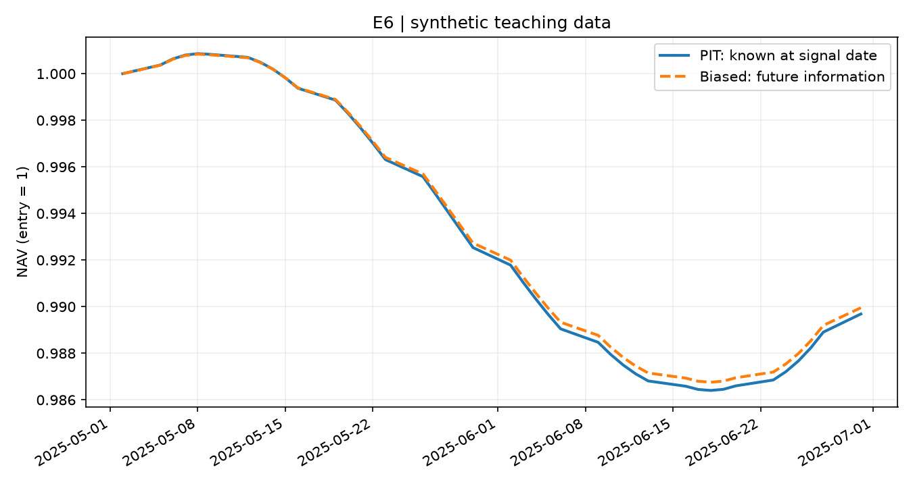
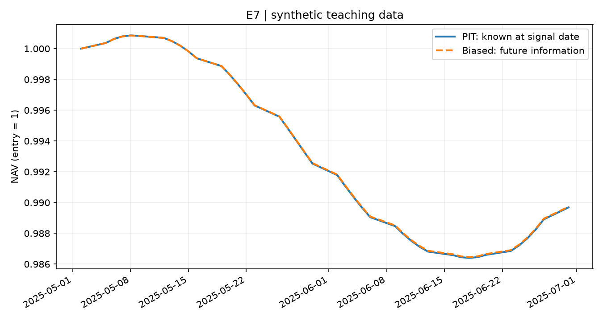

# E6/E7：只改变信息集的对照实验

运行 `python experiments/a_bias/run.py`，使用 B+A 合成库，生成本目录的 CSV、PNG 和 `results.md`。运行 `python experiments/a_bias/e11_replay.py`，生成 E11 选股和净值 CSV；数据库修改会回滚。

固定条件：2025-05-01 日终信号，下一交易日 05-02 收盘买入，持有到 06-30。每股初始等权、期间不调仓、不计费用；两组使用相同的 B 后复权价格。需要的价格缺失或非正就停止，不静默删除股票。

- E6：股票池固定为 5 月的历史成员，筛选一季报 ROE ≥ 9%。正确查询读 PIT；错误查询忽略可用日期，提前用了 8 月更正，剔除了 sh.600001。
- E7：不筛财报，正确查询用 5 月成员，错误查询用年底成员，把 sh.600001 换成了 7 月才加入的 sh.600002。其余选股和计算完全相同。
- E11：本地将一条原始 ROE 从 10% 改为 7%，财务快照恢复原版本后，选股与固定价格下的净值恢复一致。完整交易回测由 C 的引擎接入。

`*_selection.csv` 可逐只查差异，`*_nav.csv` 可复算曲线。图表中的 PIT 为正确时点查询，Biased 为使用未来信息。曲线差异来自信息集，不代表真实市场策略收益，也不要求错误方式总是赚得更多。

